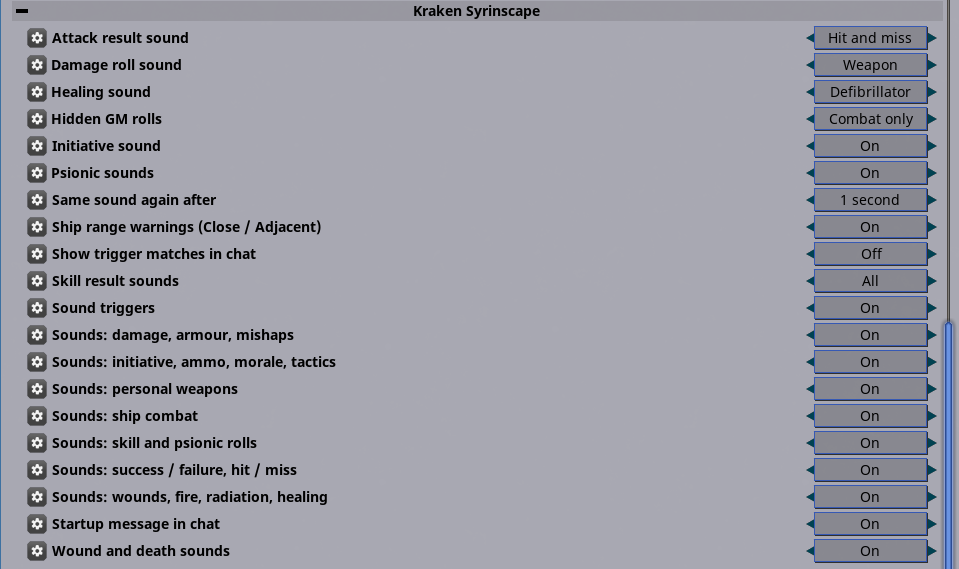
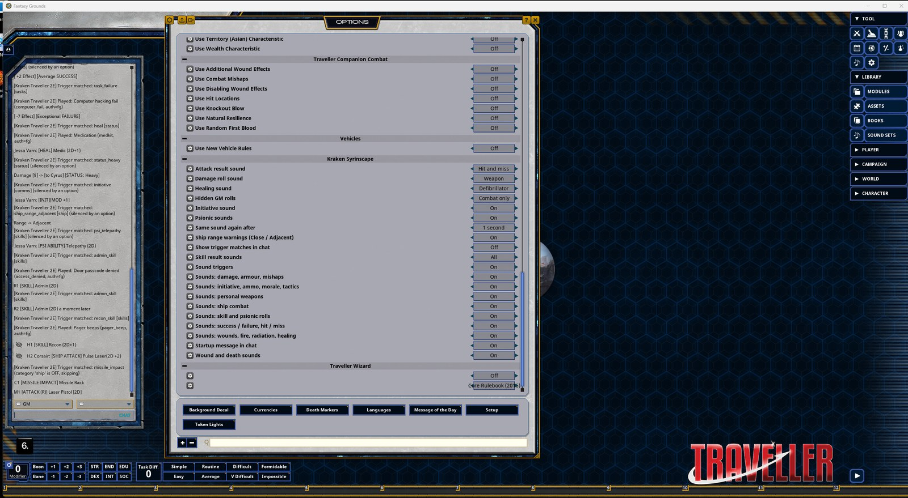

# Kraken Traveller 2E Syrinscape

A Fantasy Grounds Unity extension for SmiteWorks' **Mongoose Traveller (2E) ruleset (MGT2)** that plays **Syrinscape** sci-fi sound effects on its own as the game happens: the right gun for the weapon fired, a ricochet on a miss, a pulse laser or missile salvo in ship combat, a Geiger counter on radiation, a defibrillator on healing, an alarm on a vehicle critical hit, and more.

91 sounds from Syrinscape's sci-fi packs, 143 triggers, and every setting in the Options window so the game leader makes the call.

> 📰 **What's new:** see the [Changelog](CHANGELOG.md).

## Screenshots

**All settings in Options > Kraken Syrinscape**

**In Fantasy Grounds, with "Show trigger matches in chat" on**

## What it plays

| Category | Plays on |
| --- | --- |
| Personal weapons | Attack and damage rolls, by weapon: pistols, revolvers, rifles, shotguns, machineguns, lasers, gauss, plasma (PGMP, FGMP), stunners, flamers, grenades, rocket launchers, blades, clubs, Pocket Nuke |
| Ship combat | Ship attacks by weapon (pulse and beam lasers, laser bays and barbettes, particle beams, missiles, torpedoes, sandcasters, meson, fusion, plasma, railguns), launches, missile impacts, point defence, very high yield, ship damage, critical hits, vehicle criticals, Close/Adjacent range |
| Damage, armour, mishaps | Damage type (kinetic, laser, stun, energy, plasma, fire, explosion), armour reduced, combat mishap, "weapon explodes", critical attacks |
| Wounds, fire, radiation, healing | Wound levels, unconscious, death, disabling wounds, fire, radiation, heal rolls |
| Skill and psionic rolls | Pilot, Astrogation, Engineer (j-drive, life support), Medic, Electronics, Mechanic, Recon, Stealth, Explosives, Heavy Weapons, Language, Admin, Deception and others; telepathy, telekinesis and other psionics |
| Success / failure, hit / miss | Task results and attack hit / miss |
| Initiative, ammo, morale, tactics | Initiative, out of ammo, crew morale, tactics |

Only the host (the GM) plays sounds. Players hear them through the Syrinscape web player.

## Options

Settings > Options > **Kraken Syrinscape** (saved with the campaign):

| Option | Choices |
| --- | --- |
| Sound triggers | On / Off |
| Hidden GM rolls | Silent / **Combat only** / All |
| Sounds: (each of the 7 categories) | On / Off |
| Damage roll sound | **Weapon** / Impact / Both |
| Attack result sound | **Hit and miss** / Hit only / Miss only / Off |
| Skill result sounds | **All** / Exceptional only / Successes only / Failures only / Off |
| Wound and death sounds | On / Off |
| Initiative sound | On / Off |
| Ship range warnings (Close / Adjacent) | On / Off |
| Psionic sounds | On / Off |
| Healing sound | **Defibrillator** / Medikit / Off |
| Same sound again after | **1** / 3 / 5 / 10 seconds |
| Startup message in chat | On / Off |
| Show trigger matches in chat | On / Off |

*Hidden GM rolls, Combat only:* NPC and ship attacks, damage, wounds and hit/miss play; hidden skill checks stay quiet so the sound gives nothing away.

## Install

1. Download `KrakenTraveller2ESyrinscape.ext` from the latest [**Release**](../../releases/latest).
2. Put it in your Fantasy Grounds data folder under `extensions\` (usually `%appdata%\SmiteWorks\Fantasy Grounds\extensions`).
3. On the FGU load screen, select your MGT2 campaign, click **Extensions**, and enable **Kraken Traveller 2E Syrinscape**.

### Requirements
- Fantasy Grounds Unity and the Mongoose Traveller (2E) ruleset
- A **Syrinscape Online** subscription with the sci-fi sounds, set up in Fantasy Grounds' own Syrinscape settings (Sound Sets > Settings > Syrinscape: Authorization, and a Web Player Session if your players listen in their browser)

## Use

Once FGU's Syrinscape settings are filled in there is nothing to do: sounds play as the chat shows rolls. Open the Syrinscape web player (FGU's **Invite** button, or `/krakensyrin invite`), turn its volume up and click once in the page so the browser allows sound.

Chat commands (GM only):

| Command | What it does |
| --- | --- |
| `/krakensyrin status` | Whether it is on, and whether FGU's Syrinscape token and session are set |
| `/krakensyrin invite` | Posts the Syrinscape links: GM controls to you, the player link to everyone |
| `/krakensyrin test <sound>` | Plays one sound, e.g. `/krakensyrin test laser_pistol` |
| `/krakensyrin hidden off\|combat\|all` | Sounds for hidden GM rolls (same as the option) |
| `/krakensyrin toggle <category> on\|off` | A category on or off (same as the options) |
| `/krakensyrin config` | A small window with the category toggles |
| `/krakensyrin debug on\|off` | Shows which trigger matched and what played |

## Troubleshooting

- **No sound at all:** `/krakensyrin status` should show `fg_auth=set`. Check the web player's volume slider (it can start at zero) and click once in its page. `/krakensyrin test explosion` checks playback on its own.
- **NPC attacks are silent:** set *Hidden GM rolls* to Combat only or All.
- **A sound plays once when it fired twice quickly:** Fantasy Grounds drops a repeated identical request within about a second, and the *Same sound again after* option adds its own wait.
- **Some sounds are quiet:** a few Syrinscape elements (Distress Signal, Pager beeps, Short Circuit) are quieter than the rest; set their volume in Syrinscape or turn the category off.

## Release

`python release.py --sync` copies the extension from `<FG data>/extensions/KrakenTraveller2ESyrinscape`, builds `KrakenTraveller2ESyrinscape.ext` and publishes a GitHub Release with it attached (the tag is `v` plus the version in `extension.xml`). It needs Python 3 and an authenticated GitHub CLI (`gh`). `--build-only` builds without publishing.

## See also

- [Kraken Traveller Character Wizard](https://github.com/krakenunbound/kraken-traveller-charwizard)
- [Kraken AD&D 2E Syrinscape](https://github.com/krakenunbound/kraken-adnd-2e-syrinscape)

Sounds by [Syrinscape](https://syrinscape.com); a Syrinscape subscription is needed to hear them. Not affiliated with Syrinscape, SmiteWorks or Mongoose Publishing.
